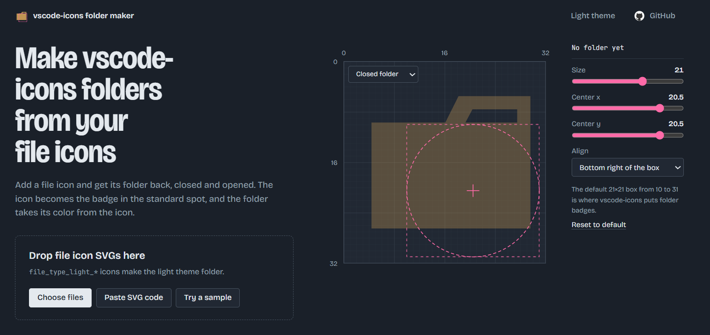

# vscode-icons folder icon maker

A browser tool from [vscode-icons](https://github.com/vscode-icons/vscode-icons)
for making folder icons out of file icons. Give it a `file_type_*.svg` and it
creates the matching `folder_type_*.svg` and `folder_type_*_opened.svg`, ready
to add to the vscode-icons repo.

The file icon is placed as a badge in the same spot as the built-in folder
badges. The folder color comes from the icon's main color, so the badge stays
readable on both the closed and opened folder.

**[Open the folder icon maker](https://vscode-icons.github.io/folder-icon-maker/)**.
It runs entirely in your browser, and your icons are never uploaded.



## Output

Each input icon gives two files, closed and opened, named the way vscode-icons
expects:

| Input                      | Output                                                            |
| -------------------------- | ----------------------------------------------------------------- |
| `file_type_name.svg`       | `folder_type_name.svg`, `folder_type_name_opened.svg`             |
| `file_type_light_name.svg` | `folder_type_light_name.svg`, `folder_type_light_name_opened.svg` |

Files named `file_type_light_*` are made into light theme folders automatically.
For other icons, pick **Light theme** in the icon's theme picker.

## Adding the icons to vscode-icons

The files this tool makes are ready to go into a pull request on
[vscode-icons/vscode-icons](https://github.com/vscode-icons/vscode-icons):

1. Copy the downloaded SVGs into the `icons/` folder.
2. Add an entry for the folder in `src/iconsManifest/supportedFolders.ts`,
   listing the folder names it should match. Set `light: true` if you also made
   `folder_type_light_*` files.
3. Check the icons in VS Code, then open a pull request.

Read the
[vscode-icons contribution guide](https://github.com/vscode-icons/vscode-icons/wiki/Contributing)
before opening the pull request.

## Contributing

Bug reports and pull requests are welcome in
[vscode-icons/folder-icon-maker](https://github.com/vscode-icons/folder-icon-maker).
Requests for new icons go to the main
[vscode-icons](https://github.com/vscode-icons/vscode-icons) repo.

There is no build step. To run the tool locally, open `index.html` in a browser,
or serve the folder with any static server:

```sh
npx serve .
```
